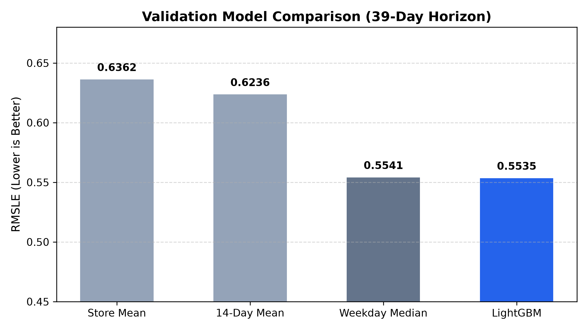

# COMP1818 – Restaurant Demand Forecasting

Coursework repository for **COMP1818 Artificial Intelligence Applications** (University of Greenwich, 2026–27).

> Status: work in progress. Sections marked TODO are completed as the project progresses.

## 1. Project summary

TODO – one paragraph: the research question and what is being compared.

## 2. Repository layout

```
data/
  raw/          # original dataset files (NOT committed; see "Data" below)
  processed/    # cleaned / feature-engineered data (generated by the code)
src/            # source code (data loading, baselines, models, evaluation)
notebooks/      # exploratory analysis
results/        # metrics tables and figures produced by the code
```

## 3. Data

TODO – dataset name, source URL, licence, date range, how to obtain it.

The raw data is not redistributed in this repository. If the dataset licence does not permit redistribution, download it yourself using the steps below.

TODO – exact download steps (and the Kaggle CLI command, if the Kaggle dataset is used).

## 4. Setup

TODO – Python version, then:

```bash
python -m venv .venv
# Windows (PowerShell): .venv\Scripts\Activate.ps1
# macOS/Linux: source .venv/bin/activate
pip install -r requirements.txt
```

## 5. How to reproduce the results

TODO – the exact commands, in order, that regenerate every table and figure in the report. A marker should be able to run these from a fresh clone with no debugging.

## 6. Methods compared

TODO – list: trivial baselines, classical model(s), machine-learning model(s), pretrained time-series model, and the extension.

## 7. Evaluation

TODO – train/test split (time-ordered), metrics used and why, number of rolling windows / seeds.


## 8. Results

TODO – final results table (copied from `results/`).
## Validation Results (39-Day Horizon)

Strict chronological split evaluated from 2017-03-15 to 2017-04-22 (28,031 observations):

| Model | Family | RMSLE | MAE | RMSE | Notes |
|---|---|---|---|---|---|
| **Store Overall Mean** | Baseline | 0.6362 | 9.1852 | 14.2497 | Historical average per store |
| **Recent 14-Day Mean** | Baseline | 0.6236 | 9.0993 | 14.3582 | Moving average level |
| **Same-Weekday Median** | Baseline | 0.5541 | 7.6723 | 12.7537 | Weekly seasonality |
| **LightGBM Regressor** | Machine Learning | **0.5535** | 7.9593 | 13.2568 | Gradient boosted trees with calendar & holiday features |
| **ETS (Holt-Winters)** | Statistical TS | **0.4864** | 7.3414 | 10.2325 | Top-10 active series (N=389) with additive weekly seasonality |



## 9. References

TODO – papers, datasets and libraries used.

## 10. Academic integrity

Generative AI was used for preparation only (planning and explanation), in line with the module brief. All code, analysis and written work is the author's own. See the AI declaration in the submitted report.
