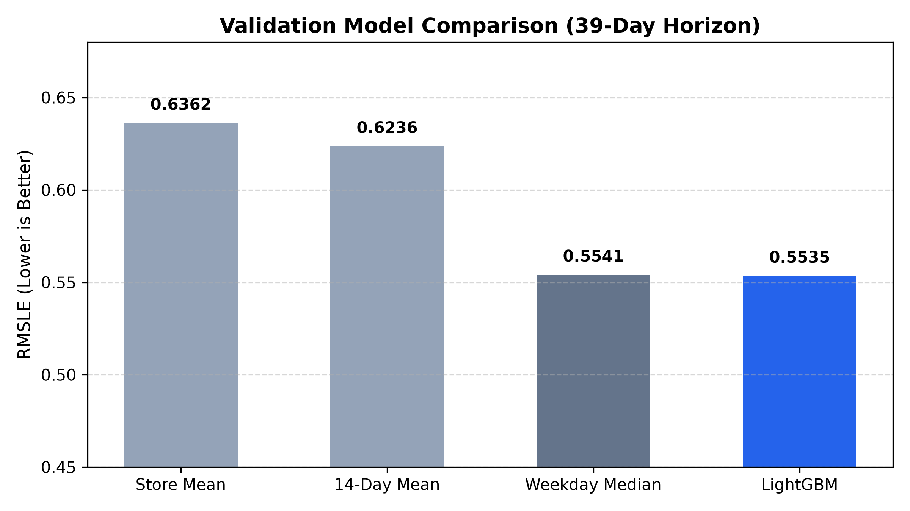

# COMP1818 – Restaurant Demand Forecasting

Coursework repository for **COMP1818 Artificial Intelligence Applications** (University of Greenwich, 2026–27).


## 1. Project Title

Benchmarking Statistical, Machine Learning, and
Seasonal Baseline Models for Restaurant Demand
Forecasting under Irregular Trading Patterns


## 2. Repository layout

```
data/
  raw/          # original dataset files (NOT committed; see "Data" below)
  processed/    # cleaned / feature-engineered data (generated by the code)
src/            # source code (data loading, baselines, models, evaluation)
notebooks/      # exploratory analysis
results/        # metrics tables and figures produced by the code
```

## 3. Dataset Information
- **Dataset Name:** Recruit Restaurant Visitor Forecasting
- **Source URL:** [https://www.kaggle.com/c/recruit-restaurant-visitor-forecasting/data](https://www.kaggle.com/c/recruit-restaurant-visitor-forecasting/data)
- **Licence:** Competition data is provided by Recruit Holdings Co., Ltd. for educational and non-commercial research use under the official Kaggle Competition Rules.
- **Date Range:** 
  - Training set: 1 January 2016 – 22 April 2017 (252,108 visits across 829 restaurants)
  - Test horizon: 23 April 2017 – 31 May 2017 (39-day prediction window across 821 restaurants)

The raw data is not redistributed in this repository in compliance with competition licensing terms.

### How to Obtain the Data

#### Option 1: Manual Download via Browser
1. Log in to [Kaggle](https://www.kaggle.com) and navigate to the [Recruit Restaurant Visitor Forecasting](https://www.kaggle.com/c/recruit-restaurant-visitor-forecasting/data) competition page.
2. Accept the competition rules on the **Rules** tab.
3. Download the competition archive or individual CSV files (`air_visit_data.csv`, `date_info.csv`, `air_store_info.csv`, `sample_submission.csv`).
4. Extract all files directly into the local project directory 

#### Option 2: Using the Kaggle API CLI
Ensure your `kaggle.json` API token is configured in `~/.kaggle/kaggle.json` (or `%USERPROFILE%\.kaggle\kaggle.json` on Windows), then run:

```bash
# Create raw data folder
mkdir -p data/raw

# Download and unzip competition files
kaggle competitions download -c recruit-restaurant-visitor-forecasting -p data/raw/
unzip -o data/raw/recruit-restaurant-visitor-forecasting.zip -d data/raw/
```

## 4. Setup

Tested with **Python 3.10+** (Python 3.14).

```bash
# Create and activate virtual environment
python -m venv .venv
# Windows (PowerShell):
.venv\Scripts\Activate.ps1
# macOS/Linux:
source .venv/bin/activate

# Install required dependencies
pip install -r requirements.txt
```

## 5. How to Reproduce the Results

Run the scripts in order from the repository root:

```bash
# 1. Run exploratory data analysis (EDA)
python -m notebooks.01_eda

# 2. Evaluate chronological baselines
python -m src.baseline

# 3. Train and evaluate LightGBM model
python -m src.train_lgbm

# 4. Train and evaluate ETS seasonal benchmark (Top 10 stores)
python -m src.train_ets

# 5. Generate validation comparison figure
python -m src.plot_results
```

The output figure is saved to `reports/figures/model_comparison.png`.

## 6. Methods Compared

- **Baselines:**
  - *Store Overall Mean:* Historical static mean per restaurant.
  - *Recent 14-Day Moving Average:* Short-term rolling average level prior to forecast cutoff.
  - *Same-Weekday Historical Median:* Historical median conditioned on day-of-week per store to capture recurring weekly cyclicity.
- **Machine Learning:**
  - *LightGBM Regressor:* Gradient boosted decision trees trained on log-transformed visitors ($\ln(y+1)$) to directly optimize RMSLE, with calendar, holiday, and leakage-free store target statistics.
- **Statistical Time Series:**
  - *ETS (Holt-Winters):* Univariate exponential smoothing with additive trend and additive weekly seasonality ($\text{seasonal\_periods}=7$).

## 7. Evaluation Protocol

- **Split Strategy:** Strict chronological out-of-time split.
- **Origin Date ($T_0$):** 14 March 2017.
- **Validation Window:** 15 March 2017 – 22 April 2017 (exactly 39 days, matching the competition test horizon).
- **Validation Sample:** Exactly $N = 28,031$ observed restaurant-days.
- **Scoring Rule:** Models are evaluated strictly on observed trading days ($y_{i,t} > 0$); unobserved/closed days are omitted from loss computation rather than imputed as zero.
- **Primary Metric:** Root Mean Squared Logarithmic Error (RMSLE). Secondary metrics: MAE and RMSE.

## 8. Validation Results (39-Day Horizon)

Strict chronological split evaluated from 15 March 2017 to 22 April 2017 ($N = 28,031$):

| Model | Family | RMSLE | MAE | RMSE | Notes |
|---|---|:---:|:---:|:---:|---|
| **Store Overall Mean** | Baseline | 0.6362 | 9.1852 | 14.2497 | Historical average per store |
| **Recent 14-Day Mean** | Baseline | 0.6236 | 9.0993 | 14.3582 | Moving average level |
| **Same-Weekday Median** | Baseline | 0.5541 | 7.6723 | 12.7537 | Captures strong weekly cyclicity |
| **LightGBM Regressor** | Machine Learning | **0.5535** | 7.9593 | 13.2568 | GBDT with calendar & holiday features |
| **ETS (Holt-Winters)** | Statistical TS | **0.4864** | 7.3414 | 10.2325 | Top-10 active series ($N = 389$) |



## 9. References

1. **Arab, I. & Benitez, R. (2025).** *Benchmarking Time Series Forecasting Models: From Statistical Techniques to Foundation Models in Real-World Applications.* arXiv preprint arXiv:2502.03395.
2. **Hyndman, R. J. & Athanasopoulos, G. (2018).** *Forecasting: Principles and Practice* (2nd ed.). OTexts, Melbourne, Australia.
3. **Ke, G., Meng, Q., Finley, T., Wang, T., Chen, W., Ma, W., Ye, Q., & Liu, T. Y. (2017).** *LightGBM: A Highly Efficient Gradient Boosting Decision Tree.* Advances in Neural Information Processing Systems (NeurIPS), 30, 3146–3154.
4. **Recruit Holdings Co., Ltd. & Kaggle (2017).** *Recruit Restaurant Visitor Forecasting Competition.* [https://www.kaggle.com/c/recruit-restaurant-visitor-forecasting](https://www.kaggle.com/c/recruit-restaurant-visitor-forecasting).

## 10. Academic Integrity

Generative AI was used for preparation only (planning and explanation), in line with the module brief. All code, analysis and written work is the author's own. See the AI declaration in the submitted report.


